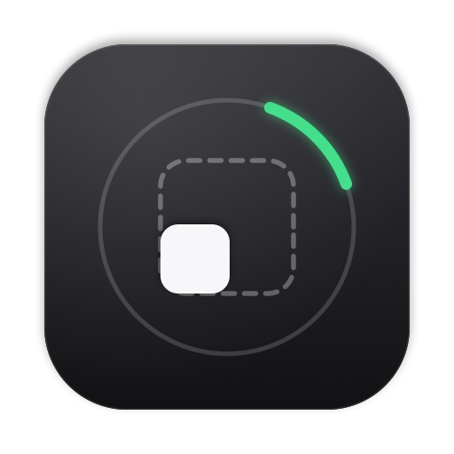
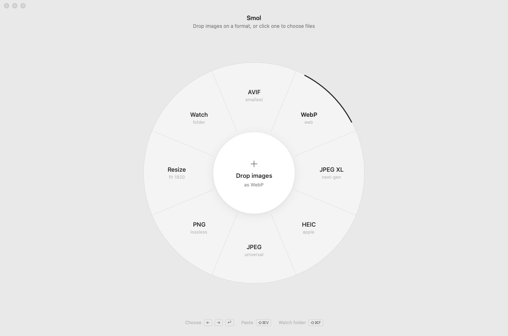
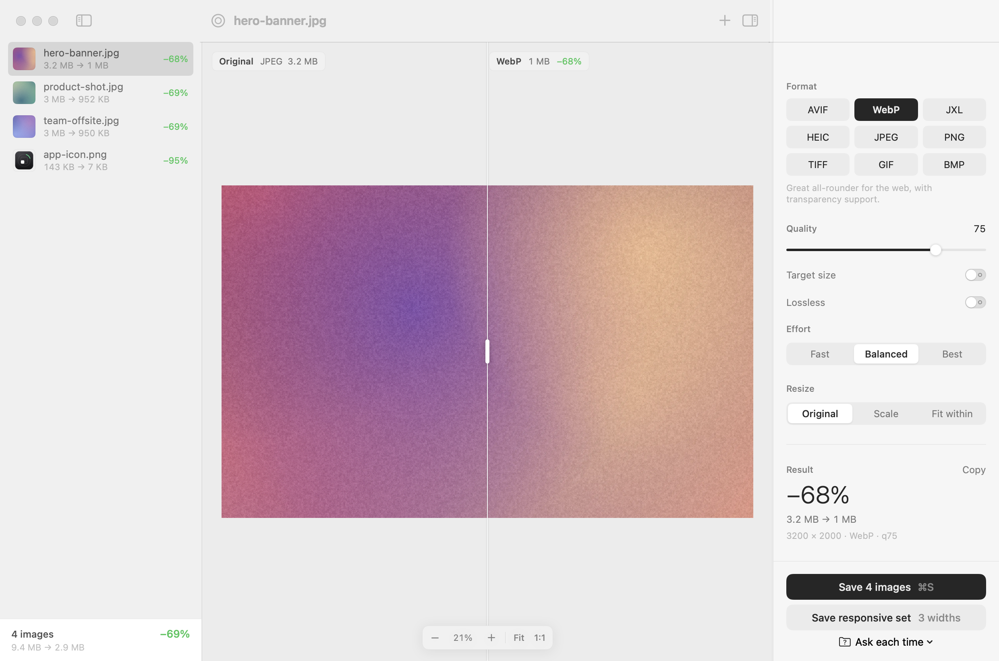
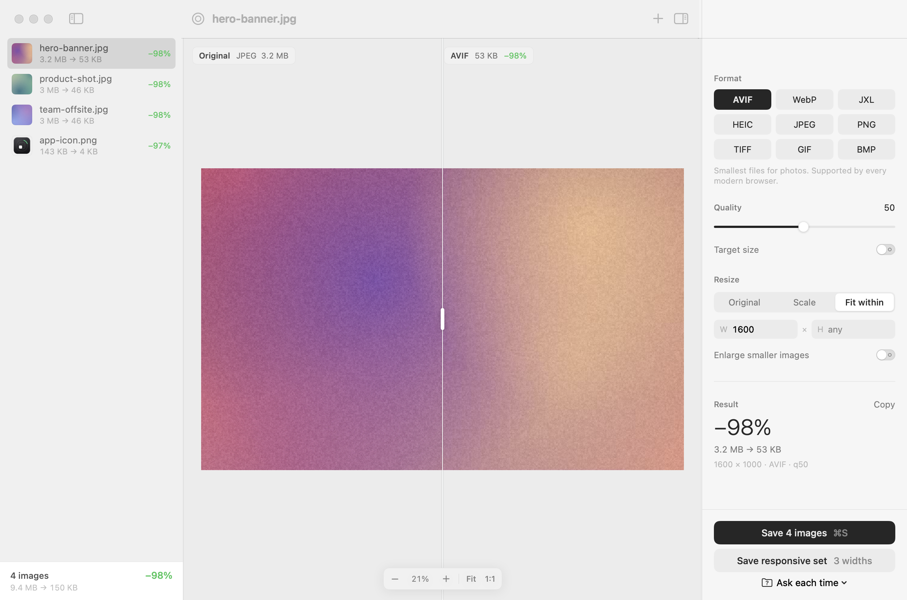
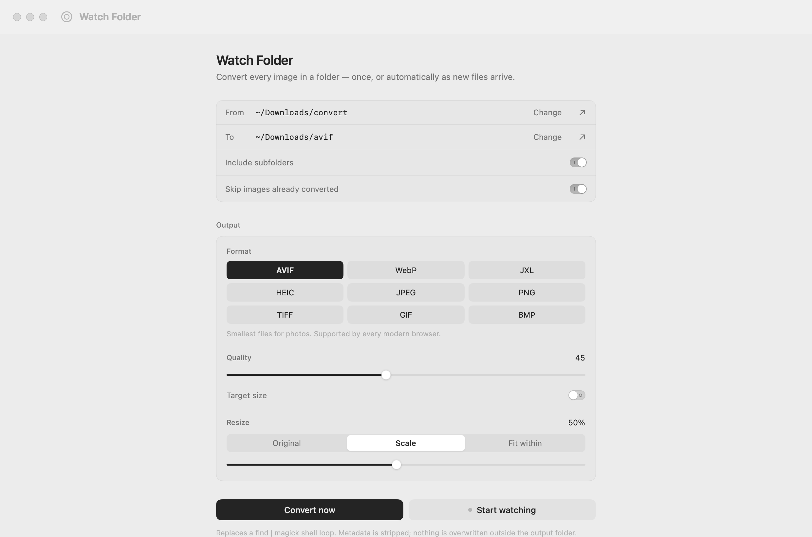
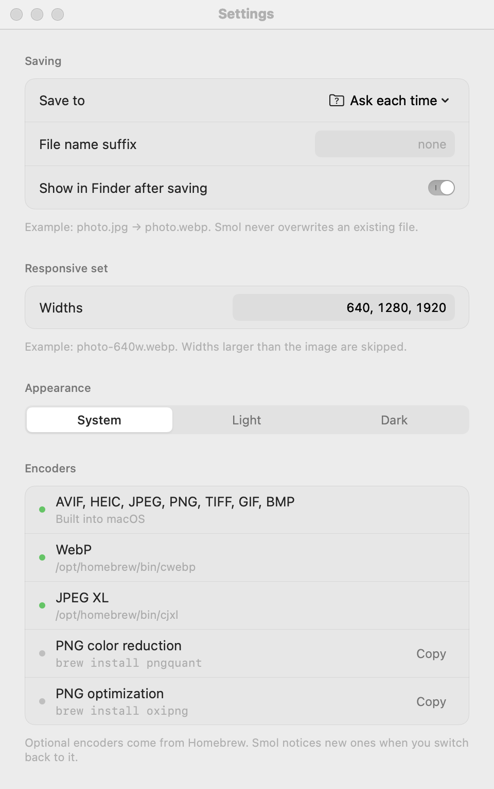

<p align="center">
  
</p>

<h1 align="center">Smol</h1>

<p align="center">
  A tiny, native Mac app that makes images small.<br>
  Drop them on a format. Compare before and after. Save.
</p>

<p align="center">
  <a href="https://github.com/brijraj-rana/smol/actions/workflows/ci.yml"></a>
  
  
  
</p>

<p align="center">
  <picture>
    <source media="(prefers-color-scheme: dark)" srcset="docs/home-dark.png">
    
  </picture>
</p>

## What it does

- **Converts and compresses** to AVIF, WebP, JPEG XL, HEIC, JPEG, PNG, TIFF, GIF and BMP. Reads anything macOS can open, including RAW, PSD and HEIC.
- **Shows you the difference.** A split view with the original on the left and the result on the right, with live file sizes.
- **Hits a target size.** Ask for "under 200 KB" and Smol finds the best quality that fits.
- **Resizes on the way out.** Scale by percent, or fit within a width, a height or both. It never enlarges unless you ask.
- **Makes responsive sets.** One image becomes `hero-640w.webp`, `hero-1280w.webp` and `hero-1920w.webp`, and the `` tag for them lands on your clipboard.
- **Works from the clipboard.** Paste a screenshot with ⌘V, copy the compressed result back out.
- **Watches a folder.** Point it at a folder and every new image is converted as it arrives.
- **Stays out of the way.** Under 4 MB, no account, no upload. Everything happens on your Mac.
- **Comes with a CLI** that uses the same engine, for scripts.

<p align="center">
  <picture>
    <source media="(prefers-color-scheme: dark)" srcset="docs/editor-dark.png">
    
  </picture>
</p>

## Install

### Download

Get `Smol-x.y.z.dmg` from the [latest release](https://github.com/brijraj-rana/smol/releases/latest), open it and drag Smol to Applications. It runs on Apple Silicon and Intel, macOS 14 or later.

The app is not notarized, so macOS blocks the first launch. Either allow it under System Settings → Privacy & Security → Open Anyway, or run:

```bash
xattr -dr com.apple.quarantine /Applications/Smol.app
```

### Build from source

Requires macOS 14 or later and Xcode 16 or later (for the Swift toolchain).

```bash
git clone https://github.com/brijraj-rana/smol.git
cd smol
./scripts/build-app.sh --install   # builds, copies Smol.app to /Applications, links the `smol` CLI
```

Most formats work out of the box. Two need a Homebrew encoder, and two more are optional extras for PNG:

```bash
brew install webp jpeg-xl      # WebP and JPEG XL
brew install pngquant oxipng   # optional: much smaller PNGs
```

Smol notices newly installed encoders as soon as you switch back to it. Settings (⌘,) shows what is installed.

## Using it

| Do this | To |
|---|---|
| Drop images or a folder on a dial segment | Convert to that format |
| Drop on the center, or press ⌘O | Use the current format |
| ← → then ↩, or 1–8 | Drive the dial from the keyboard |
| ⌘V | Paste an image or copied files from the clipboard (⇧⌘V while typing in a field) |
| Resize → Fit within | Cap the width, the height or both. Leave a side empty to cap only the other |
| Drag the divider | Compare original and result |
| Pinch, or ⌘-scroll | Zoom. ⌘0 fits, ⌘1 shows actual pixels |
| ⌘S | Save everything to your chosen place |
| Copy next to the result, or ⇧⌘C | Copy the compressed image, ready to paste anywhere |
| Save responsive set | Save the selected image at each width and copy its `` tag |
| Drag a row out of the list | Drop the compressed file straight into Finder, Slack or Figma |
| ⇧⌘F | Open Watch Folder |

Where files go is up to you: ask each time, next to the originals, or one fixed folder. Set it under the Save button or in Settings. Smol never overwrites an existing file, and it always strips location and camera metadata while keeping the color profile.

### Responsive sets

Save responsive set writes the selected image once per width, in the current format and quality, and copies a tag like this:

```html

```

The widths are 640, 1280 and 1920 unless you change them in Settings (⌘,). Widths larger than the image are skipped, so nothing is ever enlarged. An image smaller than every width is saved once at its own size.

<p align="center">
  
</p>

<p align="center">
  
  
</p>

## Command line

```bash
smol photo.jpg -f avif -q 45
smol hero.png -f webp --max-size 200kb
smol ~/Downloads/convert -f avif -q 45 --resize 50% -o ~/Downloads/avif
smol hero.png -f webp --resize 1600          # longest edge 1600, never enlarged
smol hero.png -f avif --srcset | pbcopy      # 640, 1280 and 1920 wide, tag on the clipboard
smol --help
```

| Flag | Does |
|---|---|
| `--resize 50%` | Scale by percent |
| `--resize 1600` | Cap the longest edge |
| `--resize 1920x1080` | Fit within a box, keeping the aspect ratio |
| `--resize 1600x` or `--resize x900` | Cap only the width, or only the height |
| `--srcset` | Write one file per width (640, 1280, 1920) and print the `` tag |
| `--widths 480,960,1440` | Choose the widths. Implies `--srcset` |
| `--sizes "(min-width: 60em) 50vw, 100vw"` | Set the `sizes` attribute of the tag |

With `--srcset`, progress goes to stderr and only the tag goes to stdout, so it can be piped or redirected.

## Design notes

Smol is a design-engineering exercise as much as a utility. The details that shaped it:

- **A dial, not a form.** Format is the first decision, so it is the first screen. Eight targets arranged around the drop zone turn "pick a format, then pick files" into one drag.
- **One indicator that travels.** A single arc on the dial's edge glides to whatever you point at and rests on the current format. It always takes the short way round and uses the same spring everywhere.
- **Color means something.** The interface is monochrome. Green only ever means "saved" or "running". Red only ever means "failed".
- **Numbers that hold still.** Every size and percentage uses tabular figures, so values do not jitter as they update.
- **Feedback you can feel.** Dragging a file across dial segments gives a soft trackpad tick at each boundary.
- **Plain words on hover.** The line under the title explains whatever you are pointing at.
- **Keyboard first.** Every action has a shortcut, and the dial is fully usable without a pointer.
- **Respectful motion.** Animations are short and purposeful, and they switch off with Reduce Motion. The dial is labelled for VoiceOver.
- **A small system.** Tokens and about ten components live in [`DesignSystem.swift`](Sources/Smol/Views/DesignSystem.swift). Light and dark mode come from the same definitions.

## How it is built

```
Sources/
  SmolCore/    UI-free engine: formats, settings, decode, resize, encode, folder scanning
  Smol/        SwiftUI app: Model/ (state) and Views/ (dial, editor, compare, watch, settings)
  smol-cli/    command-line front end to SmolCore
Tests/         engine tests (every format round-trips, target size, resize, responsive sets, naming, edge cases)
scripts/       build-app.sh bundles the app; make-icon.swift draws the icon in code
```

The engine has no UI dependencies, so the app and the CLI are both thin layers over it.

### Adding a format

1. Add a case to `OutputFormat` and fill in its properties.
2. Write a type that conforms to `FormatEncoder` (one method: image in, data out).
3. Return it from `EncoderRegistry`.

The dial, the settings panel, Watch Folder and the CLI pick it up from there. The round-trip test covers it automatically.

### Developing

```bash
swift build && swift test       # or open Package.swift in Xcode
./scripts/build-app.sh --open   # build and launch the app bundle
```

## License

[MIT](LICENSE)
